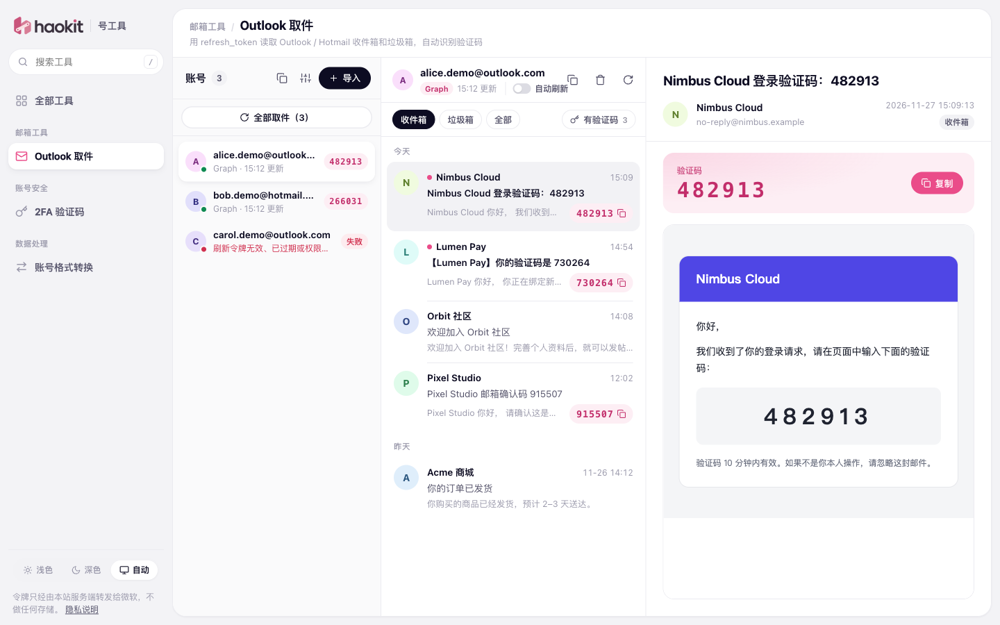
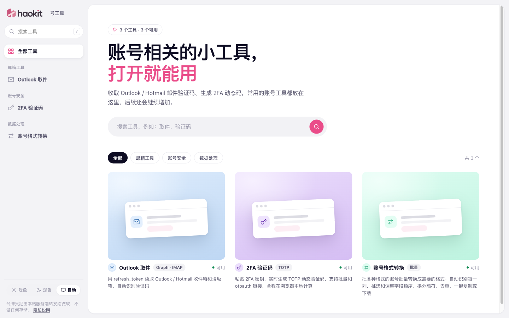
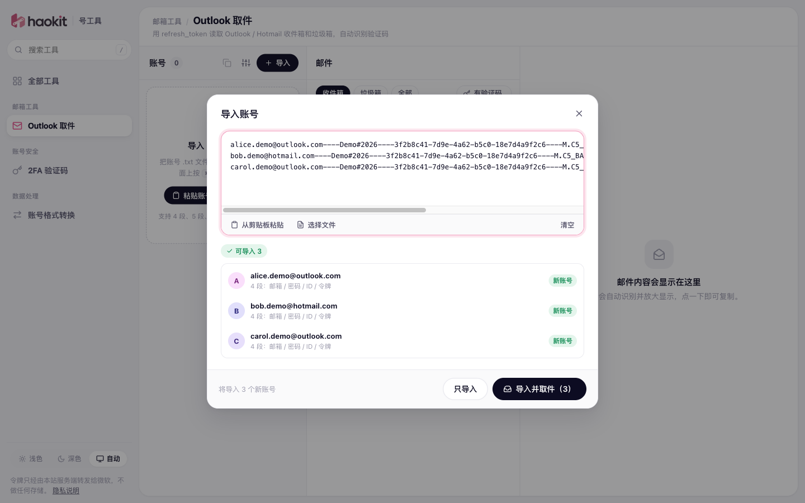
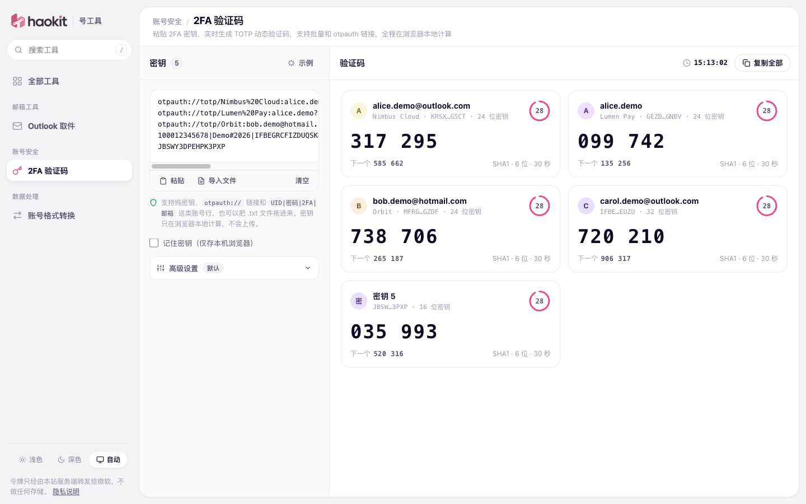
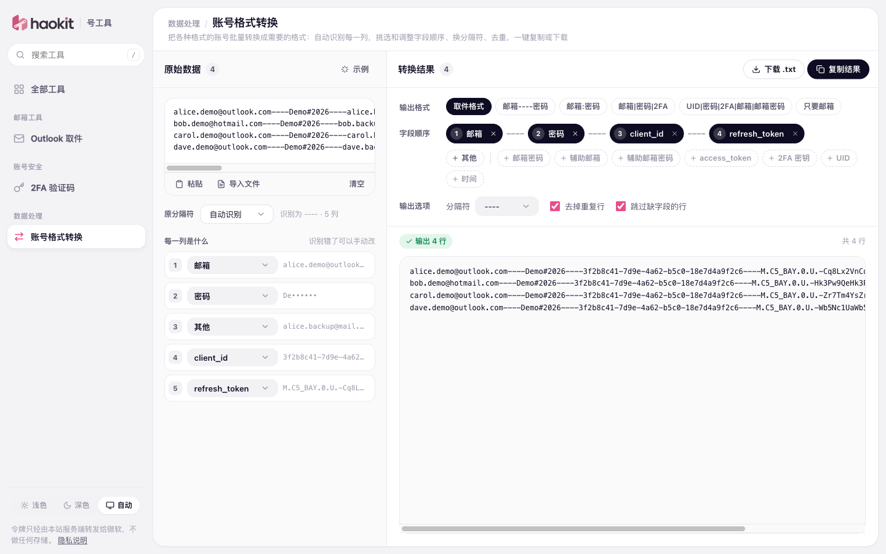
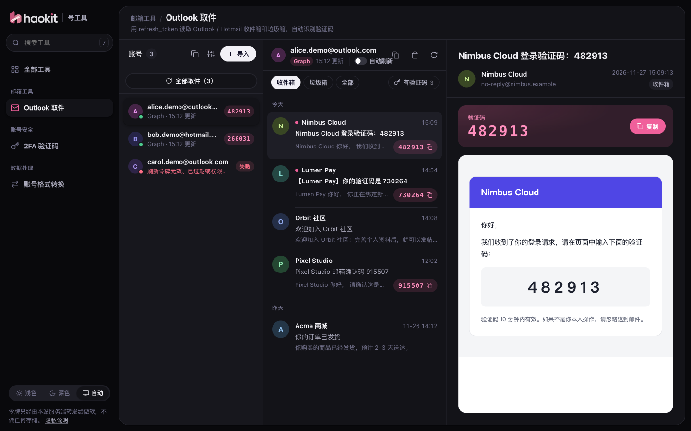
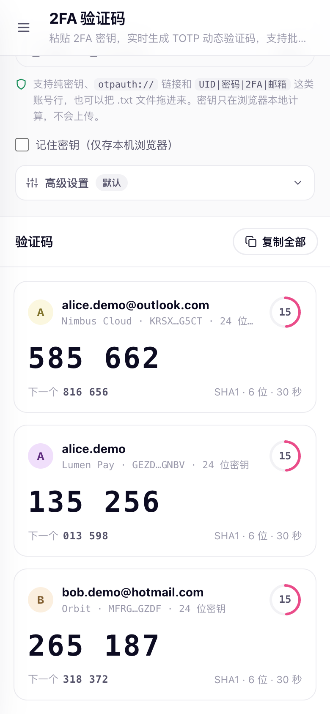

<p align="center">
  <picture>
    <source media="(prefers-color-scheme: dark)" srcset="public/brand/logo-400x120-dark.png">
    
  </picture>
</p>

<p align="center">
  常用账号工具合集：Outlook 取件、2FA 验证码、账号格式转换，打开网页就能用。<br>
  在线使用：<a href="https://haokit.xyz"><b>haokit.xyz</b></a>
</p>



## 功能

| 工具 | 地址 | 能做什么 |
| --- | --- | --- |
| **Outlook / Hotmail 取件** | [`/outlook`](https://haokit.xyz/outlook) | 用 `refresh_token` 批量读取收件箱和垃圾箱，自动识别验证码，一键复制；Graph API 失败时自动改用 IMAP |
| **2FA 验证码** | [`/2fa`](https://haokit.xyz/2fa) | 粘贴密钥、`otpauth://` 链接或 `UID\|密码\|2FA\|邮箱` 账号行，实时生成 TOTP 动态码，全程在浏览器本地计算 |
| **账号格式转换** | [`/convert`](https://haokit.xyz/convert) | 自动识别每一列是什么，挑选和调整字段顺序、换分隔符、去重，复制或下载 .txt |

- 账号格式不挑：4 段、5 段、6 段都行，字段顺序不限，支持 `----`、`---`、`|`、Tab、冒号等分隔符和「邮箱：xxx」这类带注释的写法。
- 隐私优先：2FA 密钥和格式转换只在浏览器里处理；取件令牌只经服务器转发给微软，不存储、不写日志。
- 浅色 / 深色 / 跟随系统三种主题，手机上也能用。
- 工具由一份注册表生成导航、首页卡片、页面标题和 sitemap，加新工具不用改布局。

## 截图

> 截图里的账号、邮件和密钥都是演示数据。

<table>
  <tr>
    <td width="50%"><br><sub>首页：搜索和分组筛选所有工具</sub></td>
    <td width="50%"><br><sub>导入账号：粘贴或拖入文件，逐行预览识别结果</sub></td>
  </tr>
  <tr>
    <td><br><sub>2FA 验证码：当前码、下一个码和倒计时，点击即可复制</sub></td>
    <td><br><sub>账号格式转换：识别列、调整字段顺序、一键导出</sub></td>
  </tr>
  <tr>
    <td><br><sub>深色模式</sub></td>
    <td align="center"><br><sub>手机端</sub></td>
  </tr>
</table>

## 快速开始

需要 Node.js 20 或以上（生产环境用 22）。

```bash
npm install
npm run dev        # 开发模式，改动后端代码自动重启
```

打开 <http://127.0.0.1:3000>。生产运行用 `npm start`。2FA 工具依赖浏览器的 Web Crypto，只能在 HTTPS 或 localhost 下使用。

## 部署

| 方式 | 说明 | 文档 |
| --- | --- | --- |
| 1Panel + Docker | 当前线上用的方式：容器只监听本机，由 1Panel 的 OpenResty 反向代理并提供 HTTPS | [deploy/1panel.md](deploy/1panel.md) |
| Caddy + systemd | 没有面板的服务器：Caddy 自动申请证书，systemd 管理进程 | [deploy/README.md](deploy/README.md) |

1Panel 方式更新代码只需在本机运行：

```bash
deploy/push.sh root@服务器IP ~/.ssh/私钥
```

脚本会上传代码、重建镜像、重启容器并等健康检查通过，旧版本保留在服务器上用于回滚。

## 配置

全部通过环境变量设置，线上写在 `/etc/haokit.env`，完整说明见 [.env.example](.env.example)。

| 变量 | 默认值 | 说明 |
| --- | --- | --- |
| `PORT` / `HOST` | `3000` / `127.0.0.1` | 监听端口和地址；生产环境保持 127.0.0.1，端口建议换成随机高位端口 |
| `SITE_URL` | 空（按请求域名生成） | 正式地址，如 `https://haokit.xyz`，用于 canonical 和 sitemap |
| `TRUST_PROXY` | `loopback` | 信任哪些反向代理转发的真实 IP 和协议 |
| `CLIENT_IP_HEADER` | 空 | 套 Cloudflare 时设为 `cf-connecting-ip` |
| `RATE_LIMIT_MAX` / `RATE_LIMIT_WINDOW_SEC` | `300` / `600` | 取件接口每个 IP 每 10 分钟最多 300 次；设为 0 关闭 |
| `MAX_CONCURRENT_FETCH` / `MAX_CONCURRENT_PER_IP` | `20` / `5` | 全站 / 单个 IP 同时取件的上限，超出的排队 |
| `FETCH_QUEUE_TIMEOUT_SEC` | `30` | 排队超过这个时间返回「服务器繁忙」 |
| `CF_ANALYTICS_TOKEN` | 空 | Cloudflare Web Analytics 站点令牌，不填就不统计 |
| `MS_TENANT` | `common` | 微软登录租户，个人号也可用 `consumers` |
| `OUTLOOK_IMAP_HOST` | `outlook.office365.com` | IMAP 服务器 |

## 技术栈

- 后端：Node.js + Express 5，[imapflow](https://github.com/postalsys/imapflow) 读 IMAP，[mailparser](https://github.com/nodemailer/mailparser) 解析邮件。
- 前端：原生 ES Modules，没有构建步骤；每个工具是一个按需加载的模块。
- 部署：Docker（只装生产依赖、非 root、只读文件系统）或 systemd；Caddy / OpenResty 提供 HTTPS。

## 页面地址与 SEO

- 每个工具有独立地址：`/`、`/outlook`、`/2fa`、`/convert`、`/privacy`。旧的 `#/outlook`、`#/totp` 链接会自动跳到新地址，`/totp` 返回 301 到 `/2fa`。
- 服务器按地址把标题、描述、canonical、分享卡片和一段无脚本简介直接写进 HTML（`server/lib/pages.js`），不执行 JavaScript 的搜索引擎也能看到每页内容；不存在的地址返回 404 并带 `noindex`。
- `robots.txt`、`sitemap.xml` 由服务器根据工具注册表自动生成。
- 网站名称和首页文案在 `public/assets/site.js`，每个工具的搜索标题和描述在 `public/tools/registry.js` 的 `seo` 字段。

## 安全与隐私

- 取件接口按 IP 限流、限制并发（`server/lib/rate-limit.js`、`server/lib/limiter.js`），超出返回 429 / 503 和中文提示。
- 安全响应头（`server/lib/security.js`）：内容安全策略只允许本站脚本，index.html 里的内联主题脚本按哈希放行（服务器自动计算）；邮件正文的 iframe 会继承这套策略，所以放行了外部图片、样式和字体，脚本仍然禁止。HTTPS 请求加 HSTS。
- 访问统计：设置 `CF_ANALYTICS_TOKEN` 后，服务器在每个页面末尾加上 Cloudflare Web Analytics 的统计脚本，同时在 CSP 里放行它，并把 Referrer-Policy 从 `no-referrer` 改为 `strict-origin`（Cloudflare 要靠来源域名识别网站）。不设置就完全不统计。隐私说明页会根据页面里有没有统计脚本自动切换说明。
- 日志规则：只打印错误信息，永远不要打印 `req.body` 或请求头——取件请求里有用户的 refresh_token。

## 各工具的详细规则

<details>
<summary><b>Outlook 取件</b></summary>

- 导入：点左上角「导入」打开导入窗口，可以粘贴、从剪贴板读取、选择或拖入 .txt / .csv 文件（单个 5 MB 以内）；也可以在页面空白处直接按 ⌘V / Ctrl+V，或把文件拖到工具区域。导入前会逐行预览识别结果，标出新账号、重复和无法识别的行，确认后选「导入并取件」或「只导入」。
- 账号多于 6 个时出现筛选框；读取方式、每次读取数量、记住账号、清空全部都在账号栏的设置按钮（滑杆图标）里；单个账号可在邮件栏顶部移除。
- 切换到其他工具再回来，账号、已取到的邮件和选中状态都会保留，不会重新取件（刷新浏览器页面后清空，要长期保存请勾选「记住账号」）。
- 账号一行一个，段数不限（4 段、5 段、6 段……），字段顺序不限，`#` 开头的行会被忽略。识别规则在 `public/assets/lib/accounts.js`，和格式转换共用。
- 分隔符按优先级：`----` → `---` → `|` → Tab → 英文 `:` / 中文 `：` → 空格。冒号只用于不带注释的数据。
- 字段前可以带注释，例如 `邮箱：abc@hotmail.com---密码：xxx---令牌：M.C5…---Client ID：…`，常见的中英文注释（邮箱、密码、令牌、refresh_token、client_id、备注等）会自动去掉。
- 每一段按内容识别：

  | 字段 | 识别方式 |
  | --- | --- |
  | 邮箱 | 优先 outlook / hotmail / live / msn 域名，其他真实邮箱算辅助邮箱 |
  | client_id | GUID 格式 |
  | refresh_token | `M.` 开头（个人号）或 `0.A` 开头（企业号）；都没有时取最长且不像 access_token 的长串 |
  | access_token | `eyJ` 或 `Ew` 开头的长串，识别后忽略 |
  | 密码 | 紧跟邮箱的那一段；紧跟辅助邮箱的算辅助邮箱密码；`UID\|密码\|2FA\|邮箱\|邮箱密码` 这种以数字 UID 开头的行，第 2 段是密码、紧跟邮箱的是邮箱密码 |
  | 其他 | 2FA 密钥、UID（6–20 位数字）、时间戳、日期等，只做标注 |

  账号列表里会显示每行的段数和识别结果，鼠标悬停可以看到逐段明细（密码打码）。规则在 `public/tools/outlook/parse.js`。
- 读取方式：**自动**先用 Graph API，失败（例如令牌没有 `Mail.Read` 权限）再用 IMAP（XOAUTH2）。
- 文件夹可选收件箱、垃圾箱或全部，每次读取 5 到 50 封。
- 验证码从主题和正文里识别，点击即可复制；账号列表里也会显示每个账号最新的验证码。
- 开启「自动刷新」后每 10 秒刷新当前账号，有新邮件会提示。
- 微软刷新令牌时会返回新的 `refresh_token`，「导出账号」会把它替换进原来那一行，方便保存。
- 邮件正文在沙箱 iframe 中渲染，不执行邮件里的脚本。
- 「记住账号」默认关闭；打开后账号只保存在当前浏览器的 localStorage。

</details>

<details>
<summary><b>2FA 验证码</b></summary>

- 密钥一行一个，支持三种写法：
  - 纯密钥：`JBSWY3DPEHPK3PXP`，大小写、空格分组都可以（`jbsw y3dp ehpk 3pxp`）。
  - `otpauth://totp/…` 链接：会读取里面的备注、发行方、位数、周期、算法。
  - 带备注或账号的行：`UID|密码|2FA|邮箱|邮箱密码`、`备注|密钥`、`邮箱----密码----密钥` 等，分隔符和取件工具一致。取密钥的顺序和 2fa.fun 一致：先看第 3 段，再看第 1 段，都不是密钥时再在其余字段里找 Base32 那一段（至少 16 位）。
- 可以粘贴、从剪贴板读取、选择或拖入 .txt 文件；输入框随内容自动长高。
- 不支持 HOTP（计数器）类型和谷歌身份验证器的批量导出链接，遇到时会提示原因。
- 位数、周期、算法收在默认折叠的「高级设置」里，默认 6 位、30 秒、SHA1；改过之后会标出「已修改」并保持展开，可一键恢复默认。`otpauth://` 链接里自带的参数优先。
- 「高级设置」里有算法自检：打开页面时在当前浏览器里跑一遍 RFC 6238 的 18 组标准测试向量。
- 每张卡片显示当前码、下一个码、倒计时圆环和识别到的密钥位数（方便核对选中的是不是对的那段），最后 5 秒圆环变红。点验证码复制时会按当前时间重新计算一次，切回页面时也会立即刷新，避免复制到后台标签页里过期的码。
- 已和 2fa.fun 在同一时刻对比过多组密钥（含 `UID|密码|2FA|邮箱|邮箱密码` 格式），结果一致。
- 用浏览器自带的 Web Crypto 计算，密钥不会发送到服务器。浏览器只在 HTTPS 或 localhost 下开放这个接口，部署到服务器时要配 HTTPS。
- 验证码按本机时间计算，时间不准会导致验证码错误，页面右上角显示了本机时间方便核对。
- 「记住密钥」默认关闭；打开后密钥只保存在当前浏览器的 localStorage。

</details>

<details>
<summary><b>账号格式转换</b></summary>

- 粘贴、从剪贴板读取、选择或拖入 .txt 文件。原分隔符默认自动识别（多数行用的那个），也可以手动指定：`----` `---` `|` Tab 冒号 逗号 空格。
- 左侧「每一列是什么」按多数行的识别结果给每一列定字段，识别错了可以用下拉框改，改过的列标「已改」，点一下恢复自动识别；不想要的列选「忽略」。有行的列数和多数行不一样时会提醒。
- 右侧选输出格式：取件格式、邮箱----密码、邮箱:密码、邮箱|密码|2FA、UID|密码|2FA|邮箱|邮箱密码、只要邮箱；也可以自定义：点 × 移除字段，点下面的「+ 字段」按顺序添加，拖动字段调整顺序。输出分隔符可换。
- 「去掉重复行」和「跳过缺字段的行」默认开启；所选字段在原始数据里没有对应列时会标黄提示。
- 结果可一键复制或下载 .txt。整个转换在浏览器里完成，不经过服务器，原始数据也不会被保存。

</details>

## 目录结构

```
server/
  index.js                 # Express 入口，自动挂载 server/tools/*/index.js
  tools/outlook/           # 取件接口：POST /api/outlook/messages
    microsoft.js           #   refresh_token → access_token，错误码翻译
    graph.js               #   Graph API 读信
    imap.js                #   IMAP 读信
  lib/
    config.js              # 环境变量配置、访问者真实 IP
    pages.js               # 页面渲染（每页的 SEO 标签、统计脚本、404）、robots.txt、sitemap.xml
    security.js            # 安全响应头（CSP、HSTS 等）
    rate-limit.js          # 按 IP 限流
    limiter.js             # 并发控制（排队、超时）
    template.js            # 读取 index.html 模板，计算内联脚本哈希
deploy/                    # 两套部署方式：1Panel + Docker（docker-compose.yml、push.sh、1panel.md）；Caddy + systemd（Caddyfile、服务文件、日志上限、README.md）
docs/screenshots/          # README 用的页面截图
Dockerfile                 # 运行镜像（只装生产依赖，非 root 运行）
public/
  index.html               # 外壳：侧边栏（logo、搜索、导航、主题）+ 悬浮内容面板；服务器在这里写入每页的 SEO 标签
  favicon.ico、site.webmanifest
  brand/                   # 网站实际使用的 logo 和图标，由 haokit-rose-assets 整理而来（含深色模式的浅色字标版本）
  haokit-rose-assets/      # 当前 logo 原始素材（玫红版）
  haokit-logo-assets/      # 旧版黑金 logo 素材，网站已不再使用
  assets/
    app.css                # 设计变量（深浅色）、外壳、通用组件、首页
    app.js                 # 路由（真实路径，兼容旧 #/ 链接）、导航搜索、「/」快捷键、主题（浅色/深色/自动）
    site.js                # 网站名称、首页和隐私页的标题描述
    ui.js                  # 公共函数：toast、复制、api、存储、时间格式、头像色、弹窗、文件拖放
    icons.js               # 图标
    lib/accounts.js        # 账号行通用解析：分隔符识别、注释去除、按内容判断字段（取件和格式转换共用）
    lib/otp.js             # 从邮件里识别验证码，其他工具可复用
    lib/totp.js            # TOTP / HOTP 计算（Base32 解码 + Web Crypto），通过 RFC 6238 测试向量
  tools/
    registry.js            # 工具注册表
    home.js                # 首页：大标题 + 搜索 + 分组筛选 + 工具卡片画廊
    privacy.js             # 隐私说明页
    outlook/               # Outlook 取件：账号 | 邮件列表 | 阅读区 三栏
    totp/                  # 2FA 验证码（页面地址 /2fa）：密钥栏 | 验证码卡片墙；parse.js 负责解析各种密钥写法
    convert/               # 账号格式转换：原始数据 + 列识别 | 输出设置 + 结果
```

## 新增一个工具

假设新工具的 `id` 是 `example`（现成的完整例子可以看 `public/tools/totp/`）：

1. 新建 `public/tools/example/index.js`：

   ```js
   export function mount(el, ctx) {
     el.innerHTML = `<div class="page"><div class="card"><div class="card-body">…</div></div></div>`;
     // ctx 里有 toast、copyText、api、loadCss、store、icon、esc
     return () => { /* 离开页面时清理定时器、事件 */ };
   }
   ```

   每次进入页面，外壳都会给工具一个新的容器 `el`，离开时整个容器被移除，绑在 `el` 里的事件会跟着释放；绑在 `document`、`window` 上的事件和定时器要在返回的清理函数里自己解除。需要在切换页面后保留的数据（比如输入框内容），放在模块顶层的变量里。

2. 在 `public/tools/registry.js` 的 `tools` 里加一项（还没做好时可以先写 `soon: true` 占位，不写 `load`）：

   ```js
   { id: 'example', name: '示例工具', desc: '…', icon: 'grid', group: 'mail', tone: 160,
     seo: { title: '示例工具 - 一句话卖点 | 号工具', description: '给搜索引擎看的一两句介绍' },
     css: '/tools/example/example.css',   // 没有自己的样式可以不写
     load: () => import('./example/index.js') },
   ```

3. 需要后端时，新建 `server/tools/example/index.js` 并导出 `router`（Express Router），重启后自动挂载到 `/api/example`。面向公网的接口记得像取件接口一样加上限流。

加好后页面地址就是 `/example`，侧边栏、首页卡片、页面标题和 sitemap 会自动出现，不用改别的地方。

工具自己的样式放在工具目录里，地址写在注册表的 `css` 字段：外壳会等样式表和工具代码都加载好再挂载（期间显示加载圈），服务器也会在页面头部直接引用当前工具的样式表，刷新时不会先闪出没有样式的内容。不要在 `mount` 里再自己加载样式。新分组加到 `registry.js` 的 `groups`，新图标加到 `assets/icons.js`。

<details>
<summary><b>界面规范</b></summary>

参考 Dribbble 上邮件客户端和 SaaS 后台类作品设计：浅灰底上的侧边栏，加一块悬浮的白色圆角内容面板。

- 颜色：正文和主按钮用墨色 `--ink`（#0d0c22），强调色玫红 `--accent`（#ea4c89）只用在验证码、搜索按钮、选中图标这类需要一眼看到的地方。颜色都写成 `app.css` 顶部的变量，深色模式只改变量。
- 形状：按钮、标签、搜索框都是胶囊形（`--pill`），卡片和输入框 12–16px 圆角，内容面板 20px。
- 现成的类：`.btn`（`.primary` 墨色主按钮、`.accent` 玫红、`.ghost`、`.sm`）、`.icon-btn`、`.input`、`.chip`（`aria-pressed="true"` 为选中）、`.pill`（`-accent/-ok/-warn/-err`）、`.switch`、`.check`、`.avatar`（`style="--h:色相"`）、`.empty`、`.spinner`、`.card` / `.card-head` / `.card-body`、`.page`。
- 公共函数（`assets/ui.js`）：`openModal` 弹窗（手机上从底部弹出）、`confirmDialog` 二次确认、`acceptFileDrop` 文件拖放、`pickTextFile` 选择文本文件、`readClipboard` 读剪贴板、`autoGrow` 文本框自动长高；配套样式 `.dropzone`、`.popover`、`.btn.danger`。
- 多栏工具共用的栏头：`.col-head`（栏头）、`.col-title`（标题 + `.count-badge` 计数）、`.col-actions`（右侧按钮）、`.col-scroll`（栏内滚动区）。
- 内容区没有内边距：普通工具用 `.page` 包一层；取件、2FA 这类多栏工具可以铺满整个面板，用容器查询（`container-type: inline-size`）按面板宽度切换单栏 / 多栏。
- 首页卡片封面按注册表里的 `tone`（色相）自动生成，不需要准备图片。

</details>
